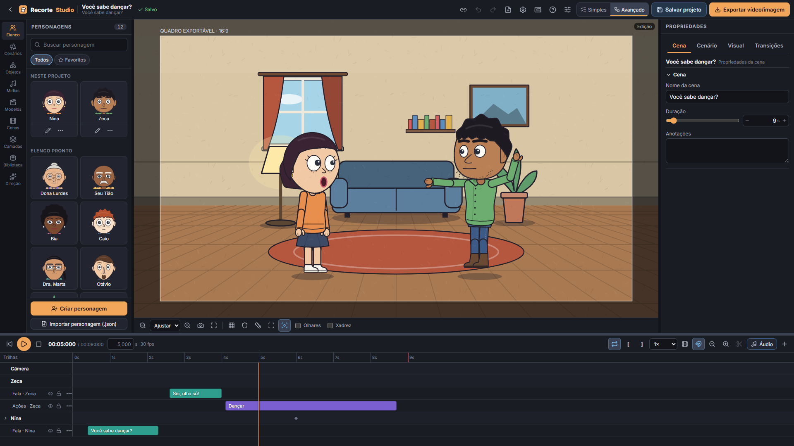

# Recorte Studio 1.2

Editor de animação narrativa 2D com personagens de recorte: cenas, camadas, timeline simples e avançada, keyframes, áudio, lip-sync básico, Criador de Personagens, de Objetos e de Cenários e exportação de vídeo. Roda no navegador, funciona offline e guarda tudo localmente. É 100% 2D: não há WebGL nem malhas 3D.



## Como abrir

**Só usar:** publique `dist/` em qualquer hospedagem estática (Vercel, por exemplo) ou rode `npm run preview`. Também abre com dois cliques em `dist/index.html`, com estas limitações: sem modo offline instalável (service worker) e sem importação de .7z/.rar/.tar.xz/.tar.bz2, que usam um worker WebAssembly.

**Desenvolver** (requer Node 22.12 ou mais novo; testado no 24):

```bash
npm install
```

```bash
npm run dev
```

```bash
npm run build
```

```bash
npm run preview
```

## Testes

```bash
npm test
```

```bash
npm run test:e2e
```

```bash
npm run lint
```

```bash
npm run typecheck
```

```bash
npm run shots
```

Para refazer as capturas do manual (public/manual) e as marcações medidas:

```bash
npm run manual:shots
```

Os testes E2E usam o Chrome instalado no sistema (`channel: 'chrome'`) e `ffprobe`/`ffmpeg` no PATH para inspecionar os vídeos exportados. Resultados registrados em [docs/TESTES.md](docs/TESTES.md).

## Fluxo em cinco minutos

1. Em **Projetos**, escolha um modelo, importe um arquivo ou crie um projeto novo.
2. **Elenco:** clique em um personagem para colocá-lo na cena; **Criar personagem** abre o criador com as 8 vistas.
3. **Cenários** e **Objetos:** móveis viram camadas editáveis. Em **Camadas**, use ↑ e ↓ para trocar quem fica na frente.
4. **Propriedades:** toda barrinha tem caixa numérica. Selecione o personagem, escolha o alvo do olhar, adicione falas e ações em **Animar**.
5. **Timeline:** arraste clips e keyframes. O losango ao lado de cada propriedade cria um keyframe no tempo atual.
6. **Exportar:** quadro PNG, sequência de PNGs, vídeo WebM (e MP4, quando o navegador tem H.264) ou pacote do projeto com mídias.

Atalhos: tecla `?` dentro do editor.

## Projetos (.jrec)

- **Salvar projeto** baixa um `.jrec` com tudo: cenas, personagens, timeline e as mídias em binário. É o único formato de projeto editável; serve de backup e para abrir em outro aparelho.
- **Exportar vídeo/imagem** gera WebM/MP4, PNG ou sequência PNG (em ZIP). Não serve para reabrir o projeto.
- **Importar** aceita .jrec, projetos .json e .zip de versões anteriores e pacotes .7z, .rar, .tar, .tar.gz, .tar.xz e .tar.bz2. O tipo é detectado pelo conteúdo.
- Os links `?projeto=` identificam projetos guardados **neste navegador**. Não são links de compartilhamento.

Detalhes do formato em [docs/MIGRACAO.md](docs/MIGRACAO.md#formato-jrec).

## Exportação de vídeo

- **Com WebCodecs (Chrome, Edge):** quadro a quadro, com timestamps exatos e mais rápido que tempo real. O áudio é mixado offline em Opus (WebM) ou AAC (MP4).
- **Sem WebCodecs:** WebM em tempo real via MediaRecorder, com sincronia aproximada. O diálogo avisa quando este é o caminho.
- A janela de exportação mostra o que foi detectado no navegador. MP4 só aparece se o codificador existir.

## IA: o que é e o que não é

| Modo | O que é | Estado |
| --- | --- | --- |
| Manual | Todo o editor | Sempre disponível, offline |
| Comandos rápidos | Regras locais. **Não é IA** | Offline, vocabulário limitado |
| IA local (Ollama) | Servidor local configurado por você | Implementado e testado com mocks. **Não foi testado contra um Ollama real** |
| IA online | Endpoint próprio, de preferência um backend que guarde a chave | Implementado e testado com mocks. **O app não guarda nem embute chaves** |

Em todos os casos o resultado é um plano estruturado validado por schema, que você revisa, aplica e desfaz. Nenhum modelo gera código, SVG ou vídeo.

## Arquitetura

```
src/engine/model       schema Zod, propriedades, operações puras do documento
src/engine/animation   keyframes, ações, lip-sync, evaluateScene(t)
src/engine/character   rig, 8 vistas, rosto, cabelos, roupas, presets
src/engine/gaze        olhar e orientação da cabeça
src/engine/world       cenários e objetos
src/engine/render      plano de quadro único para preview e exportação; montagem
src/state              documento + histórico (patches), transporte, interface
src/storage            IndexedDB (Dexie)
src/migrations         0.3/0.4 → 1.0
src/features           ai, audio, export, library, projects, templates
src/components         UI React (controles, palco, timeline, painéis, diálogos)
```

Decisões que sustentam o resto:

- **Renderizador único:** `planFrame(projeto, cena, t)` gera um plano. O preview reconcilia esse plano no DOM e a exportação o serializa em SVG e rasteriza em canvas. Guias e gizmos ficam em outro SVG e nunca entram no plano.
- **Determinismo:** tudo é função do tempo. Seek, reprodução e exportação dão o mesmo resultado, sem `Math.random` nem acúmulo de deltas.
- **Coordenadas:** origem no centro do quadro e altura fixa de 1080 unidades. Trocar 16:9 por 9:16 só muda a moldura; nada se move.
- **Histórico:** patches do Immer, com gestos agrupados em uma entrada. Blobs de mídia ficam fora do histórico.
- **Vistas:** templates discretos por vista, sem rotação contínua nem 3D. Limite assumido: não há interpolação entre vistas, a troca é um corte.

## Documentação

- [CHANGELOG.md](CHANGELOG.md): mudanças de cada versão, da 0.4 à 1.2
- **Manual:** dentro do app (Manual na tela inicial, F1 ou os ícones ? do editor); funciona offline
- [docs/ACEITACAO.md](docs/ACEITACAO.md): checklist com PASSOU, PARCIAL ou NÃO IMPLEMENTADO
- [docs/TESTES.md](docs/TESTES.md): comandos, números e ambiente
- [docs/AUDITORIA-0.4.md](docs/AUDITORIA-0.4.md): inventário do legado
- [docs/MIGRACAO.md](docs/MIGRACAO.md): como os dados antigos são convertidos
- [docs/LICENCAS.md](docs/LICENCAS.md): dependências e autoria dos assets
- [docs/capturas/](docs/capturas): capturas reais
- `legado/0.4/`: código original, sem alterações
